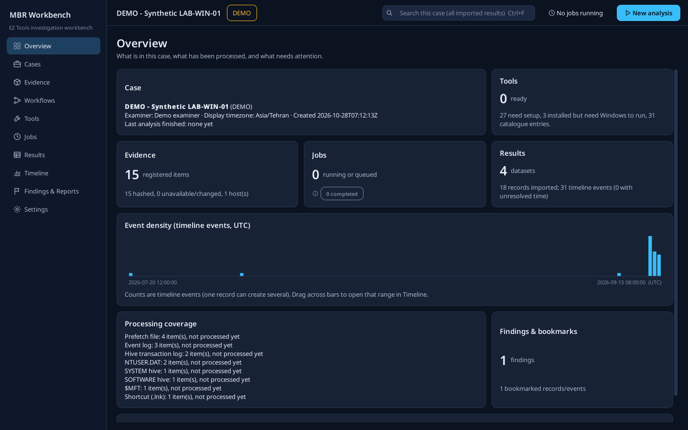

# MBR Forensic Workbench

A Windows desktop investigation workbench around **Eric Zimmerman's forensic tools**: one place to manage the full tool collection, configure command-line parsers through validated forms, run multi-tool workflows on collected evidence, explore results, build an evidence-linked timeline, record findings and export reports.

It is a wrapper and investigation workbench. It runs and opens the original tools; it does not re-implement their parsers, and it is **not an official Eric Zimmerman, ZimTech LLC or Kroll product**. The product name is configurable (`product.json` next to the executable or `MBRWB_PRODUCT_NAME`).

Stack: Python 3.12, PySide6 6.10 (Qt Widgets), SQLite, pydantic, PyYAML. Offline-first: no account, telemetry, web server or LLM.

> **Status (2026-10-28): Experimental 0.1.0 — lab use.** Built and tested on Linux; **no Windows package has been built or run yet**, and the EZ binaries were **not executed** during development (adapter options were verified statically against the official 2026.10 builds). See [TEST_RESULTS.md](TEST_RESULTS.md) and [TOOL_COVERAGE.md](TOOL_COVERAGE.md) for exactly what was and was not verified.

> **Independent review:** source startup and offscreen UI checks passed; the supplied suite produced **118 passed, 3 skipped**. Six additional issues remain open, including the frozen entry point, input/dependency integrity checks, signature enforcement, Maps-only updates, and a Windows containment failure branch. See [review notes and the Windows test guide](docs/REVIEW_AND_WINDOWS_TEST_GUIDE.md) before relying on real case results. This import preserves the original 0.1.0 application code; those issues are not marked fixed.



## Requirements (Windows)
- Windows 10/11 x64.
- For the tools: **.NET 10 Runtime** (CLI tools) and **.NET 10 Desktop Runtime** (GUI tools), x64: https://dotnet.microsoft.com/en-us/download/dotnet/10.0. Optional .NET Framework 4.7.2+ only if you use the .NET 4 builds. The workbench detects these and tells you exactly what is missing; it never installs runtimes itself.
- To run from source: Python 3.12 x64.

## Run from source
```powershell
py -3.12 -m venv .venv
.venv\Scripts\python -m pip install -r requirements\dev.txt
$env:PYTHONPATH = "src"
.venv\Scripts\python -m mbrwb
```
Options: `--case <folder>` opens a case, `--theme light|dark`, `--no-first-run`. Data lives in `%LOCALAPPDATA%\MBR Forensic Workbench` (or `MBRWB_HOME`).

## Build the Windows package
```powershell
powershell -NoProfile -File packaging\build_windows.ps1            # tests + PyInstaller one-folder + zip + SHA256SUMS
powershell -NoProfile -File packaging\build_windows.ps1 -Portable  # adds portable.flag (data next to the exe if writable)
```
Output: `dist\MBR Forensic Workbench\MBR Forensic Workbench.exe` and `dist\MBR-Forensic-Workbench-<version>-win-x64.zip`. The package contains the workbench and its Python/Qt dependencies only - **no EZ Tools, no KAPE**.

## Import the tools
On first start choose one of:
1. **Import an existing EZ Tools folder** (e.g. the destination of Get-ZimmermanTools - the `net` subfolder is found automatically) - files are copied into the tool store.
2. **Download supported tools** from `download.ericzimmermanstools.com` (HTTPS, reviewed origin; a summary is shown first).
3. **Continue and configure later**.

Later: **Tools > Import folder / Import archive / Install all eligible**, or drag a `.zip` onto the window. For air-gapped machines prepare a folder or zip of the official archives on a connected machine and import it. Then, for each CLI tool you rely on, run **Tools > (tool) > Options evidence > Verify this version** once - it captures `--help` from that exact executable and upgrades its verification level.

## First real analysis (suggested)
1. **Ctrl+N** - new case (title, examiner, timezone).
2. **Evidence > Add evidence** - pick a collected tree (for example a KAPE target output folder) -> *Inspect* -> review the preview (types, hosts, users) -> *Register evidence* (hashing runs in the background).
3. **New analysis** -> host(s) -> **Quick Windows Triage** -> review the plan (PECmd, EvtxECmd, MFTECmd are the minimum to validate) -> **Run analysis**.
4. **Jobs** - watch state, logs and outputs; check *Provenance* for the frozen executable hash and argument array.
5. **Results** - filter/search; **Timeline** - check that events appear with *tool UTC convention* and that *Open source record* lands on the right row.
6. Bookmark records, **Add to finding**, then **Findings & Reports > Report > Save HTML**.
7. Close and reopen the case.

Please record what you see (especially: do the real CSV headers match the timeline mappings? any *unsupported output schema*?) in TEST_RESULTS.md.

## Tests
```bash
QT_QPA_PLATFORM=offscreen python -m pytest -q          # unit, integration (fake tools), UI smoke
python scripts/benchmark_million.py --dir <scratch>     # synthetic 1M-row import/query/UI latency benchmark
python scripts/inspect_tool_archives.py <zips folder>   # read-only static evidence from official archives
python scripts/coverage_matrix.py > TOOL_COVERAGE.md
python scripts/screenshots.py --out docs/screenshots    # real screenshots of the running UI (offscreen)
```
Fake tools in `tests/fake_tools` exist only to test process management; their output proves nothing about the EZ tools.

## Repository layout
```
src/mbrwb/        application package (see ARCHITECTURE.md)
tests/            pytest suite (+ pe_builder.py synthetic PE files, fake_tools/)
scripts/          inspection, coverage, benchmark, screenshots
packaging/        PyInstaller spec + Windows build script
samples/          synthetic DEMO case export and example report
docs/             screenshots, benchmark results, reviewed upstream doc copies
```

## Documentation
- [USER_GUIDE.md](USER_GUIDE.md) - tools, cases, evidence, workflows, results, timeline, reports
- [ARCHITECTURE.md](ARCHITECTURE.md) - modules, case schema, process lifecycle, adapter boundaries
- [TOOL_COVERAGE.md](TOOL_COVERAGE.md) - every catalogue entry and its verification state
- [ADAPTER_DEVELOPMENT.md](ADAPTER_DEVELOPMENT.md) - adding/updating versioned adapters and mappings
- [TEST_RESULTS.md](TEST_RESULTS.md) - what was run, where, and what remains untested
- [DECISIONS.md](DECISIONS.md), [IMPLEMENTATION_STATUS.md](IMPLEMENTATION_STATUS.md), [THIRD_PARTY_NOTICES.md](THIRD_PARTY_NOTICES.md)
